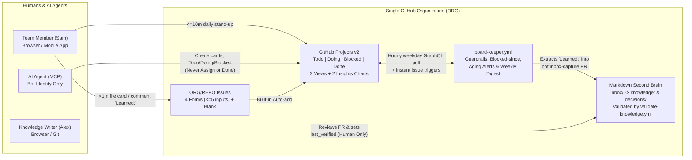

# Team Second Brain + GitHub Projects v2 Kanban Template (`ORG/REPO`)

A low-friction **Markdown Second Brain** and **GitHub Projects v2 task board + stand-up dashboard** in a single repository.
It gives a **5-to-15 person engineering team** sub-minute mobile issue capture, automated blocker accountability, and safe AI agent guardrails.
Runs 100% natively on **GitHub Free or Team** with **zero external servers** and **zero public-preview dependencies**.

---

## Who This Is For

- **Team size:** Starts at **5 people**, scales cleanly to **~15 people** inside a single GitHub organization (`ORG`).
- **Browser & mobile first (`Sam`):** 80–90% of the team uses **only** the GitHub web browser UI or iOS/Android mobile app. Filing a card, flagging a blocker, or capturing a lesson learned takes **< 60 seconds** and **never requires `git`, a terminal, or Obsidian**.
- **Curated Second Brain (`Alex`):** Only **1–2 knowledge writers** use `git` (or the browser PR review UI) to merge weekly knowledge notes from [`inbox/`](inbox/README.md) into [`knowledge/`](knowledge/README.md), [`decisions/`](decisions/README.md), and [`standards/`](standards/README.md).
- **AI Agent Ready:** Coding and assistant agents connect via the **GitHub MCP Server** (`--toolsets context,issues,projects,labels`) to triage, update `Todo`/`Doing`/`Blocked`, and draft summaries—while **only humans** may assign owners (`Assignees`), move cards to `Done`, or mark docs `verified`.

---

## System Overview

---

## Set Up in Under 1 Hour (55 Minutes Total)

| Step | Time | Action |
|---|---|---|
| **1** | **5 min** | **Create repository from template:** Click **Use this template → Create a new repository** under your organization (`ORG/REPO`). Clone locally on the admin machine or open in Codespaces. |
| **2** | **10 min** | **Create Bot Identity & add secrets:** Create an org **GitHub App** (recommended: Repository `Issues: RW`, `Contents: RW`, `Pull requests: RW`, `Metadata: R`; Organization `Projects: RW`) **or** a dedicated bot-account Fine-Grained PAT ([exact scopes in `docs/agents.md`](docs/agents.md#2-exact-token-permissions)). In **Settings → Secrets and variables → Actions**, add secrets `APP_ID` + `APP_PRIVATE_KEY` (or `PROJECT_PAT`) and repository variables `ORG_NAME` (`ORG`) and `PROJECT_NUMBER` (filled after Step 4). |
| **3** | **5 min** | **Sync the 9 repository labels:** Run `./scripts/sync-labels.sh --repo ORG/REPO` (reads [`.github/labels.yml`](.github/labels.yml) idempotently). |
| **4** | **10 min** | **Provision the Project v2 board, fields & views:** Run `gh auth refresh -s project` once, then run `./scripts/setup-project.sh --org ORG --repo REPO`. This creates the org project, configures `Status` (`Todo`, `Doing`, `Blocked`, `Done`), creates the 5 custom fields from [`project/fields.yml`](project/fields.yml), creates the 3 views from [`project/views.yml`](project/views.yml), and prints the Project Number (`N`). Set repo variable `PROJECT_NUMBER=N`. |
| **5** | **5 min** | **Configure built-in Project workflows by hand:** Open your Project → **⋯ (top-right menu) → Workflows** and set the exact toggles in the table below (takes 90 seconds; no public API exists for built-in workflows, F3). |
| **6** | **5 min** | **Set soft WIP limit & create 2 Insights charts:** On `1. Board`, click **⋯** on the `Doing` column → **Set limit** → `10` (`2 × team_size`). Click **Insights** (top-right) and create the 2 charts documented in [`project/views.md`](project/views.md#2-insights-charts-click-by-click-setup). |
| **7** | **15 min** | **Invite team & run the 15-minute walkthrough:** Share the `2. Stand-up Dashboard` link, have everyone bookmark it on desktop and phone, and walk through filing 1 real task card and the [1-page cheat sheet](docs/workflow.md#8-one-page-cheat-sheet). |

### Exact Built-In Project Workflow Toggles (Step 5)

| Built-In Workflow (Project → `⋯` → Workflows) | State | Exact Setting & Why |
|---|---|---|
| **Auto-add to project** | ✅ **ON** | Repo: `ORG/REPO`, Filter: `is:issue is:open` (keeps PRs off the board; uses 0 Actions minutes, F3/F4). |
| **Item added to project** | ✅ **ON** | Set `Status` = **`Todo`** (every new card starts in `Todo`). |
| **Item closed** | ❌ **OFF** | **Turn OFF (on by default!).** Prevents bot closes or `not planned` closures from bypassing human DoD verification. |
| **Pull request merged** | ❌ **OFF** | **Turn OFF (on by default!).** Merging code does not mean operational DoD + `Knowledge link` are verified. |
| **Auto-archive items** | ✅ **ON** | Filter: `status:Done updated:<@today-30d` (keeps the board fast while preserving 30 days of Insights chart data, F7). |

---

## Daily Use in 60 Seconds (For Non-Git Users on Browser or Phone)

You never need `git`, a terminal, or Markdown files for daily work:

1. **File a card (< 45 seconds on phone):**
   - Open the GitHub mobile app (or web browser) → **`ORG/REPO` → Issues → `+` (New Issue)**.
   - Tap **Task**, **Bug**, **Blocker**, or **Decision** (or **Open a blank issue** if in a rush).
   - Type a clear title and the 1–2 required boxes → tap **Submit**. The board automatically adds it to **`Todo`**.
2. **Start work or flag a blocker (< 30 seconds):**
   - Open the Project board → drag your card to **`Doing`** (keep **≤ 2 `Doing` cards** assigned to yourself).
   - Hit an obstacle? Drag the card to **`Blocked`** (or add label `status:blocked` from the issue screen), make sure **Assignees** has the person driving the unblock, and fill **`Blocked reason`**. Automation stamps **`Blocked since`** automatically.
3. **Finish a card & capture knowledge (< 30 seconds — zero git!):**
   - Before dragging to `Done`, ask: *"Did we learn a gotcha, fix, or decision someone will need in 30 days?"*
   - **If yes:** Post a regular issue comment starting with **`Learned:`** (for example: `Learned: service-x webhooks require exponential backoff with jitter`). Automation extracts it into `inbox/issue-<N>.md` and links it for you!
   - **If no new learning:** Set the card's **`Knowledge link`** field to **`N/A`** (or paste an existing doc path).
   - Verify the work is complete and drag the card to **`Done`** (only humans may move cards to `Done`).

---

## GitHub Free vs. GitHub Team Plan Comparison

Everything in the core template works on **both** GitHub Free and GitHub Team without any public-preview features (F13):

| Feature / Limit | GitHub Free ($0) | GitHub Team ($4/user/month) | How This Template Handles Both |
|---|---|---|---|
| **Private repos, Collaborators, Projects v2, Insights** | Unlimited / Included (F7, F13) | Unlimited / Included | Works identically on Free and Team. |
| **GitHub Actions minutes (Private repo)** | **2,000 min/month** | **3,000 min/month** | Unified [`board-keeper.yml`](.github/workflows/board-keeper.yml) uses **~332 min/mo** (<17% of Free quota). *(0 billed min if repo is public.)* |
| **Built-in Project Auto-Add workflows** | **1 per project** (F4) | **5 per project** (F4) | Core uses the 1 built-in workflow; multi-repo Actions fallback is in [`docs/optional/experimental.md`](docs/optional/experimental.md). |
| **CODEOWNERS & Protected Branches (Private repo)** | Public repos only (F13) | ✅ Enforced on private repos | [`.github/workflows/validate-knowledge.yml`](.github/workflows/validate-knowledge.yml) enforces frontmatter schema, `locked: true`, and human-only `last_verified` on **both Free and Team**; [`.github/CODEOWNERS.example`](.github/CODEOWNERS.example) adds native gatekeeping on Team. |

---

## Documentation Map

- **[`docs/architecture.md`](docs/architecture.md)** — System architecture, 4 Mermaid diagrams, who-can-do-what matrix, trust boundaries, and Actions-minute budget.
- **[`docs/workflow.md`](docs/workflow.md)** — Column rules, soft WIP, Blocked protocol, mobile DoD, worked example card `#42`, minute-by-minute 10-min stand-up script, and 1-page cheat sheet.
- **[`docs/agents.md`](docs/agents.md)** — Bot identity, exact PAT/App permissions, GitHub MCP Server config, enforcement rules, and weekly summary template.
- **[`docs/pilot.md`](docs/pilot.md)** — 2-week pilot plan, 3 measurable success criteria, daily/retro checklists, and Go/Adjust/Stop table.
- **[`docs/research.md`](docs/research.md)** — Verified platform facts (F1–F18), Projects v2 limitations & workarounds, alternatives, and build provenance.
- **[`project/views.md`](project/views.md)** — Exact filter syntax for the 3 views and click-by-click setup for the 2 Insights charts.
- **[`docs/optional/experimental.md`](docs/optional/experimental.md)** — Optional & public-preview features quarantined from the core template.
