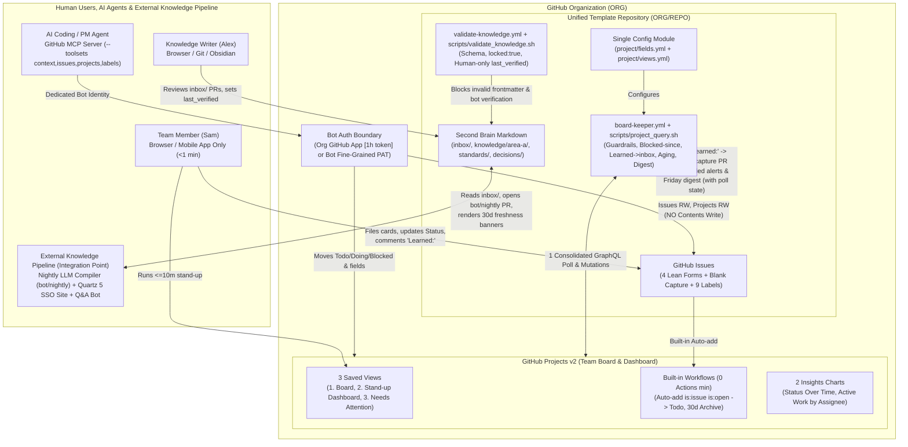
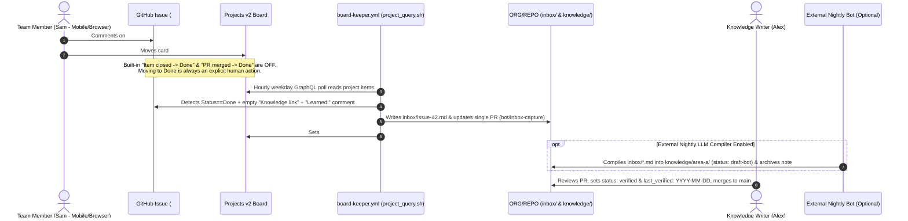

# System Architecture (Final Specification)

> **Source ADRs:** [ADR 0001: Brainstorming](decisions/0001-brainstorming.md) · [ADR 0002: Architecture Review & Simplification](decisions/0002-architecture-review.md) · [ADR 0003: Open Questions & Defaults](decisions/0003-open-questions.md)

## 1. Architecture Summary & Core Modules

`ORG/REPO` is a single-repository template uniting a **Markdown Second Brain** (`inbox/`, `knowledge/`, `standards/`, `decisions/`) and an organization-level **GitHub Projects v2 Kanban & Stand-up Dashboard** for a 5-to-15 person team on GitHub Free or Team.

Following the Stage-2 architecture simplification pass ([ADR 0002](decisions/0002-architecture-review.md)), the system is structured around **deep modules**, **zero noisy commits to `main`**, and **one configuration source of truth**:

| Module | Path | Interface & Responsibility |
|---|---|---|
| **Canonical Config** | [`project/fields.yml`](../project/fields.yml) | **Single source of truth** for project fields (`Status` + 5 custom fields), options, aging thresholds (`3d` warn, `5d` escalate), label names, and secret/variable names. Read by all scripts and workflows via `yq`. |
| **Views Config** | [`project/views.yml`](../project/views.yml), [`project/views.md`](../project/views.md) | Defines the **3 saved views** (`1. Board`, `2. Stand-up Dashboard`, `3. Needs Attention`) and **2 Insights charts**. |
| **Issue Intake** | [`.github/ISSUE_TEMPLATE/*.yml`](../.github/ISSUE_TEMPLATE/config.yml), [`.github/labels.yml`](../.github/labels.yml) | 4 mobile-friendly YAML forms (`task.yml`, `bug.yml`, `blocker.yml`, `decision.yml`, ≤ 5 inputs each, 1–2 required) + `config.yml` (`blank_issues_enabled: true`) + **9 functional labels**. |
| **Bootstrap CLI** | [`scripts/setup-project.sh`](../scripts/setup-project.sh), [`scripts/sync-labels.sh`](../scripts/sync-labels.sh) | Idempotent `gh` CLI scripts (supporting `--dry-run`) that provision the Project v2 board, fields from `project/fields.yml`, views via REST API (F12), and repository labels. |
| **Board-Keeper Engine** | [`.github/workflows/board-keeper.yml`](../.github/workflows/board-keeper.yml) → [`scripts/project_query.sh`](../scripts/project_query.sh) | **Single unified board workflow & deep script** (`--mode all|guardrails|aging|learnings|digest|issue-event`, `--input-json`, `--dry-run`). Runs on `issues` events and an hourly weekday schedule (`0 8-18 * * 1-5`) to perform: (1) human-only `Done` & `Assignees` audit, (2) automatic `Blocked since` stamping/clearing, (3) `Learned:` comment extraction from `Done` cards into `inbox/` PR (`bot/inbox-capture`), (4) morning aging/stale alerts (`08:00 UTC`), and (5) Friday `Week YYYY-WW` digest generation (`16:00 UTC`) with embedded poll state (`<!-- board-keeper:snapshot:{...} -->`). |
| **Knowledge Guard CI** | [`.github/workflows/validate-knowledge.yml`](../.github/workflows/validate-knowledge.yml) → [`scripts/validate_knowledge.sh`](../scripts/validate_knowledge.sh) | Blocking PR/push check verifying YAML frontmatter against [`_meta/schema.yaml`](../_meta/schema.yaml), protecting `locked: true` pages, and asserting that non-human actors never modify `last_verified` or set `status: verified`. |
| **Second Brain Skeleton** | [`inbox/`](../inbox/README.md), [`knowledge/area-a/`](../knowledge/area-a/README.md), [`standards/`](../standards/README.md), [`decisions/`](../decisions/README.md), [`_meta/`](../_meta/README.md), [`_templates/`](../_templates/README.md) | Curated Markdown knowledge base with bidirectional card linking (`related_cards` frontmatter ↔ `Knowledge link` project field) and [`.github/CODEOWNERS.example`](../.github/CODEOWNERS.example). |
| **Optional Extras** | [`docs/optional/experimental.md`](optional/experimental.md) | Quarantined public-preview features (Issue Artifacts F16, Agent Automation Controls F15, Multi-select F17, Org Issue Fields F10), custom `Target date`, and multi-repo auto-add workflow. |

---

## 2. Architecture Diagrams

### 2.1 System Overview



### 2.2 Card Lifecycle State Diagram (`Status`)

```mermaid
stateDiagram-v2
    [*] --> Todo : Issue opened (Human or Agent)<br/>Built-in workflow auto-adds & sets Status = Todo

    Todo --> Doing : Human or Agent starts work<br/>(Soft WIP <= 2 per Assignee; red column header if exceeded)
    Doing --> Todo : Human or Agent pauses / deprioritizes

    Todo --> Blocked : Human or Agent marks blocked<br/>Required: Assignee + Blocked reason<br/>board-keeper stamps: Blocked since = today
    Doing --> Blocked : Human or Agent hits blocker<br/>Required: Assignee + Blocked reason<br/>board-keeper stamps: Blocked since = today

    Blocked --> Doing : Blocker resolved (Human or Agent)<br/>board-keeper clears: Blocked since
    Blocked --> Todo : Unblocked & returned to queue<br/>board-keeper clears: Blocked since

    Doing --> Done : HUMAN ONLY verifies DoD<br/>Requires: Knowledge link or 'Learned:' comment<br/>(Bot transition -> flagged with policy-violation / optional revert)
    Blocked --> Done : HUMAN ONLY resolves & completes<br/>board-keeper clears: Blocked since

    Done --> Doing : Human or Agent reopens work
    Done --> [*] : Built-in auto-archive after 30 days in Done
```



### 2.3 Sequence Diagram: "Card Done → Knowledge Captured"



### 2.4 Sequence Diagram: Unified `board-keeper` Guardrail & Aging Poll

```mermaid
sequenceDiagram
    autonumber
    actor Actor as Human or AI Agent
    participant Issue as GitHub Issue
    participant Board as Projects v2 (GraphQL)
    participant Keeper as board-keeper.yml (scripts/project_query.sh)
    participant Digest as Weekly Digest Issue (Poll State Store)

    par Real-Time Issue Event Path (0 Latency)
        Actor->>Issue: Assigns user OR closes issue OR adds label "status:blocked"
        Issue->>Keeper: Triggers on: issues [assigned, unassigned, closed, reopened, labeled]
        alt Label "status:blocked" added
            Keeper->>Board: Sets Status = Blocked & "Blocked since" = today
        else Actor is a Bot (*[bot] or bot user) and assigned user or closed issue
            Keeper->>Issue: Posts audit warning + adds "policy-violation" label
            opt auto_revert: true in project/fields.yml
                Keeper->>Issue: Removes bot-added assignee / reopens issue
            end
        end
    and Hourly Weekday Poll Path (0 8-18 * * 1-5 + workflow_dispatch)
        Keeper->>Board: Single GraphQL query (items, fields, Status.creator.login)
        Keeper->>Digest: Reads previous <!-- board-keeper:snapshot:{...} --> from Digest Issue body
        loop Every Project Item in Memory
            alt Status == Blocked and "Blocked since" is empty
                Keeper->>Board: Stamps "Blocked since" = today
            else Status != Blocked and "Blocked since" is non-empty
                Keeper->>Board: Clears "Blocked since"
            end
            alt Status == Blocked and missing Assignee or Blocked reason
                Keeper->>Issue: Posts prompt comment (cooldown: 1 per 3d)
            end
            alt Status == Done and Status.creator.login is a Bot
                Keeper->>Issue: Posts audit warning + adds "policy-violation" label
                opt auto_revert: true in project/fields.yml
                    Keeper->>Board: Reverts Status -> Doing
                end
            end
            opt Morning Aging Window (08:00 UTC)
                Keeper->>Issue: Warns if Blocked >= 3d; adds "escalated" + mentions @ORG/maintainers if >= 5d; checks Doing stale >= 5d
            end
        end
        Keeper->>Digest: Updates "Week YYYY-WW" digest issue & embeds <!-- board-keeper:snapshot:{...} -->
    end
    opt Auth Failure Defense (if: failure())
        Keeper->>Issue: Uses built-in GITHUB_TOKEN to open/update "⚠️ Board-keeper auth failed" issue
    end
```

---

## 3. Trust Boundaries, Auth & Failure Defenses

### 3.1 Three Distinct Identity & Permission Tiers
1. **Humans (`Sam`, `Alex`, `@ORG/maintainers`):** Personal GitHub accounts. Only humans may set `Assignees`, move cards to `Done`, approve/merge PRs, or set `last_verified` / `status: verified`.
2. **AI Agents (via GitHub MCP Server `--toolsets context,issues,projects,labels`):** Must use a **dedicated bot machine-user Fine-Grained PAT** (or GitHub App token)—**never a human's personal PAT** (so `github.actor` and `Status.creator.login` reliably distinguish agent from human).
   - **Repository permissions:** `Issues: Read & Write`, `Metadata: Read-only`, **`Contents: No access`**, **`Pull requests: No access`**.
   - **Organization permissions:** `Projects: Read & Write`.
3. **GitHub Actions (`board-keeper.yml`):** Uses an organization **GitHub App** (`actions/create-github-app-token@v1` minting a 1-hour token from `APP_ID` + `APP_PRIVATE_KEY`) or a fallback `PROJECT_PAT` secret for Projects v2 GraphQL access, the same token opens the `bot/inbox-capture` PR; the built-in `GITHUB_TOKEN` (read-only contents) is used only for checkout and the auth-failure alert issue.

### 3.2 Defenses Against Silent Failure & Blind Spots
- **Expired PAT / Rotated App Key:** If the project token fails (`401`/`403`), `board-keeper.yml` fails fast and triggers an `if: failure()` step using the **never-expiring built-in `GITHUB_TOKEN`** to open/update a `policy-violation` issue (`"⚠️ Board-keeper authentication failed"`).
- **Zero Snapshot Commits to `main` & 60-Day Cron Keepalive:** Poll state is stored inside the active `Week YYYY-WW` digest issue body (`<!-- board-keeper:snapshot:{...} -->`) rather than committed to `main`. Repository activity on public repos stays fresh via `bot/inbox-capture` PRs and human `knowledge/` merges, `on: issues` triggers run `board-keeper.yml` even if `schedule:` ever pauses, and `workflow_dispatch` provides a 1-click manual trigger.
- **GraphQL Polling Blind Spots:** Because GraphQL returns current field values (`Status` and `Status.creator.login`) rather than full transition history:
  1. Built-in *"Item closed → Done"* and *"PR merged → Done"* are turned **OFF** so issue closes/merges cannot silently move cards to `Done`.
  2. Issue assignments, closes, and `status:blocked` labels are caught **instantly** via `on: issues` (`github.actor`).
  3. Board column drags are audited hourly via `fieldValueByName(name: "Status").creator.login` + diffing against the snapshot in the weekly digest issue body. *(Known narrow blind spot: a card dragged `Doing → Blocked → Doing` within the same hour is not stamped because it is already unblocked when the poll runs.)*

---

## 4. Who-Can-Do-What & Rule Enforcement Matrix

| Action / Rule | Human (`Sam` / `Alex`) | AI Agent (MCP / Bot) | Actions (`board-keeper` / CI) | Enforcement Type & Mechanism |
|---|---|---|---|---|
| **Create issue / card** | ✅ Yes (4 forms or blank) | ✅ Yes (labels `agent-drafted`) | ✅ Yes (Friday digest issue) | **Permission** (`Issues: Write`) + **Convention** (`agent-drafted` label) |
| **Edit `Priority`, `Area`, `Blocked reason`, `Knowledge link`** | ✅ Yes | ✅ Yes | ✅ Yes (`Knowledge link` on capture) | **Permission** (`Projects: Write`) |
| **Stamp / clear `Blocked since`** | ✅ Yes (override) | ❌ No | ✅ Yes (auto-stamps & clears) | **Automation** (`board-keeper.yml` maintains automatically) |
| **Move `Status` among `Todo`, `Doing`, `Blocked`** | ✅ Yes | ✅ Yes | ✅ Yes (Built-in auto-add → `Todo`) | **Permission** (`Projects: Write`) |
| **Move `Status` to `Done`** | ✅ **Human ONLY** | ❌ **Never** | ❌ **Never** (Close→Done is OFF) | **Automation** (`Status.creator.login` + snapshot audit → comment + `policy-violation` label; optional `auto_revert: true`) |
| **Set `Assignees` (assign owner)** | ✅ **Human ONLY** | ❌ **Never** | ❌ **Never** | **Automation** (Real-time `on: issues: [assigned]` checks `github.actor` → comment + `policy-violation` label; optional revert) |
| **Close issue as completed** | ✅ **Human ONLY** | ❌ **Never** | ❌ **Never** | **Automation** (Real-time `on: issues: [closed]` checks `github.actor`) |
| **Every `Blocked` card has Assignee, `Blocked since`, `Blocked reason`** | ✅ Fills reason & owner | ✅ May fill `Blocked reason` | ✅ Stamps `Blocked since` & audits | **Automation + View** (`board-keeper.yml` comments if missing; `2. Stand-up Dashboard` & `3. Needs Attention` filter `status:Blocked (no:assignee OR no:"Blocked reason")`) |
| **Blocker aging (≥3d warn, ≥5d escalate)** | ✅ Resolves / reassigns | ❌ No | ✅ Posts alert + `escalated` label | **Automation** (Morning check in `board-keeper.yml`, throttled to 1 alert / 3 days) |
| **Soft WIP (`Doing ≤ 2` per person)** | ✅ Self-regulates in stand-up | ✅ Checks WIP before starting | ❌ No bot nagging | **Cheap Convention** (Projects v2 column limit turns red + `2. Stand-up Dashboard` groups `Doing` by `Assignees`) |
| **Capture DoD learning (`Learned:` or `Knowledge link`)** | ✅ Comments `Learned:` or sets link | ✅ May suggest draft comment | ✅ Extracts `Learned:` → `inbox/` PR | **Automation + View** (`board-keeper.yml` opens `bot/inbox-capture` PR & sets `Knowledge link`; `3. Needs Attention` flags `status:Done no:"Knowledge link"`) |
| **Push to `main`, edit `knowledge/` directly, or merge PRs** | ✅ Via PR (`@ORG/maintainers`) | ❌ **Never** | ❌ Opens `bot/inbox-capture` PR only | **Permission** (Agent PAT has **no `Contents: Write`**) |
| **Set `last_verified` or `status: verified` on docs** | ✅ **Human ONLY** (`Alex`) | ❌ **Never** | ❌ **Never** | **Automation (Blocking CI)** (`validate-knowledge.yml` fails PR if non-human edits `last_verified` or `status: verified`) |
| **Modify `locked: true` pages (`standards/`, `decisions/`)** | ✅ Human owner via PR | ❌ **Never** | ❌ **Never** | **Automation (Blocking CI) + Permission** (`validate-knowledge.yml` on Free & Team; `CODEOWNERS` on Team) |

---

## 5. Knowledge-Layer Integration Point

The template ships the human-ready Second Brain structure at the repository root (`inbox/`, `knowledge/area-a/`, `standards/`, `decisions/`, `_meta/schema.yaml`, `_templates/`) and the blocking validator (`.github/workflows/validate-knowledge.yml`).

**How the External Nightly Compiler & Static Site Plug In (Out of Core Template Scope):**
1. **Nightly LLM Compiler (`bot/nightly`):** Runs externally on a nightly schedule, reads raw notes from `inbox/` (including `issue-<N>.md` notes extracted from `Done` cards by `board-keeper.yml`), synthesizes/updates structured pages under `knowledge/<domain>/` with `status: draft-bot` (or `knowledge/_ingested/`), moves processed notes verbatim to `_archive/inbox/YYYY-MM/`, updates manifest/ledger files (`reports/pages.json`, `state/`), and updates a single pull request (`bot/nightly`)—never force-pushing over human commits and never setting `last_verified` or `status: verified`. Contradictions are appended under a `"## Contradictions and open questions"` section on the target page rather than overwritten.
2. **Read-Only Static Site (Quartz 5) & Q&A Bot:** Builds from `main` for pages with `publish: true`. Uniform **30-day freshness banners** are derived strictly at build time from `last_verified` (**Fresh:** days 0–30; **Overdue:** day 31–60; **Stale:** day 61–90; **Archive candidate:** day 91+ requiring human confirmation)—bots never write freshness timestamps back to git.

---

## 6. Key Architectural Decisions & Actions-Minute Budget

### 6.1 Key Decisions Summary (with 1-Line Rationale)
1. **Unified `board-keeper.yml` + `scripts/project_query.sh`:** Merges guardrails, `Blocked since` stamping, `Learned:` comment-to-`inbox/` collection, morning aging alerts, and the Friday digest into 1 workflow and 1 script reading `project/fields.yml` ([ADR 0002](decisions/0002-architecture-review.md)).
2. **Poll state stored in the weekly digest issue body (`<!-- board-keeper:snapshot:{...} -->`):** Avoids committing noisy state files to `main` while tracking `Status` changes across hourly polls ([ADR 0002](decisions/0002-architecture-review.md), [ADR 0003](decisions/0003-open-questions.md)).
3. **Built-in "Item closed → Done" & "PR merged → Done" turned OFF:** Ensures `Done` is always an explicit, human-verified DoD transition on the board (`is:issue is:open` only; no PRs on board) ([ADR 0001](decisions/0001-brainstorming.md)).
4. **Visible audit by default (`auto_revert: false`):** Bot violations of human-only `Done` or `Assignees` post a warning comment + `policy-violation` label + digest entry by default, with automatic revert enabled by flipping `auto_revert: true` in `project/fields.yml`.
5. **Zero-git DoD for mobile/browser users:** Commenting `Learned: ...` on an issue automatically creates an `inbox/issue-<N>.md` PR and fills `Knowledge link`.

### 6.2 Monthly Actions-Minute Budget (Private Repo on GitHub Free = 2,000 min/mo cap)
*(On a public repository, all workflows below cost **0 billed minutes/month**. On a private repository, each job rounds up to 1 billed minute.)*

| Workflow | Trigger / Schedule | Runs / Month | Billed Min / Month (Private Repo) |
|---|---|---|---|
| **`.github/workflows/board-keeper.yml` (Scheduled Poll)** | `0 8-18 * * 1-5` (11 runs/day × 22 weekdays; runs guardrails, `Blocked since`, `Learned:` capture, `08:00` aging alerts, `Fri 16:00` digest in 1 job) | 242 | **242 min** *(or 484 min if set to `*/30`)* |
| **`.github/workflows/board-keeper.yml` (Issue Events)** | `on: issues: [assigned, unassigned, closed, reopened, labeled]` | ~60 | **60 min** |
| **`.github/workflows/validate-knowledge.yml`** | `on: pull_request` / `push` touching `knowledge/**`, `decisions/**`, `standards/**`, `docs/decisions/**` | ~30 | **30 min** |
| **Projects v2 Built-in Workflows** | Auto-add (`is:issue is:open` → `Todo`) & 30-day auto-archive | Unlimited | **0 min** *(native platform feature)* |
| **Total Monthly Cost** | — | **~332 runs** | **332 billed min/mo (16.6% of Free 2,000-min cap)** |
