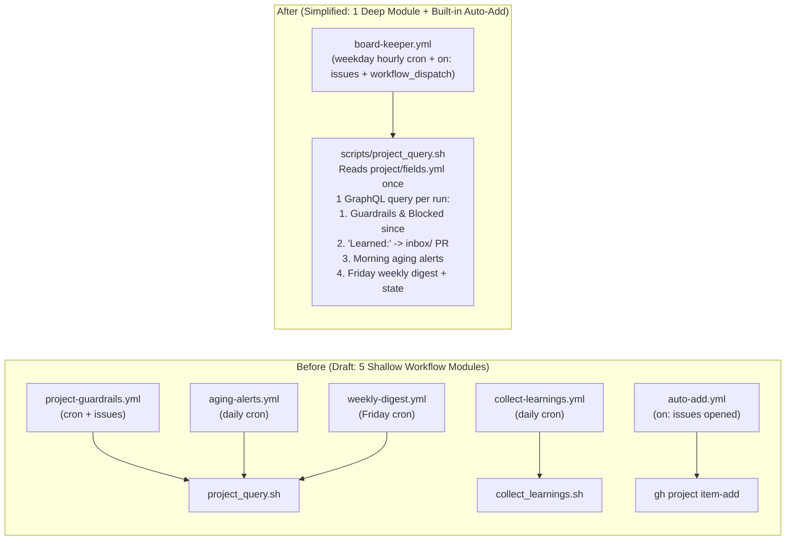

# ADR 0002: Architecture Review & Simplification Pass

## 1. Method: Adapting `improve-codebase-architecture` (ICA) to Docs + Config + Scripts + Actions

We reviewed the Stage-1 draft of [`docs/architecture.md`](../architecture.md) using the architectural vocabulary and principles from `improve-codebase-architecture`:

- **Module & Depth (Deep vs. Shallow):** A deep **module** hides substantial operational complexity behind a small, stable **interface**. In a GitHub template repository, workflows (`.github/workflows/*.yml`) and shell scripts (`scripts/*.sh`) are modules. Four separate scheduled workflow YAML files that each check out the repo, mint a GitHub App token, query the same Projects v2 GraphQL endpoint, and iterate over the same cards are **shallow modules** whose interfaces are nearly as complex as their implementations.
- **Deletion Test:** *"Would deleting this module concentrate complexity, or just move it?"* If deleting three workflow files and one helper script concentrates all project-board state transitions behind a single script interface (`scripts/project_query.sh`), the separate files failed the deletion test and should be merged.
- **Locality & Leverage:** Changing a field name (`Blocked since`), status option (`Blocked`), aging threshold (`3` days), or secret/variable reference should require editing **one module (`project/fields.yml`)**, not hunting across five workflows and three scripts.
- **Seams, Adapters, and Testability (*"The interface is the test surface"*; *"One adapter = hypothetical seam, two = real"*):** `scripts/project_query.sh` sits at a **real seam** with two adapters: (1) `.github/workflows/board-keeper.yml` in GitHub Actions and (2) local developer/admin execution (`scripts/project_query.sh --dry-run` or `--input-json`). Designing its CLI flags as the test surface lets us test all guardrail, aging, digest, and knowledge-capture logic offline against static JSON without calling the live GitHub API.
- **YAGNI:** Any file, field, label, workflow, or folder that a 5-person team will not actively use in week 1 is either deleted or moved to `docs/optional/`.

---

## 2. Architecture Review Findings Table

| ID | Category | Finding in Draft Architecture | ICA Principle Violated | Severity | Decision | Concrete Simplification Applied |
|---|---|---|---|---|---|---|
| **R1** | **Workflows (Shallow Modules)** | Draft had **4 separate board workflows** (`project-guardrails.yml`, `aging-alerts.yml`, `collect-learnings.yml`, `weekly-digest.yml`) that each authenticate, check out the repo, and run redundant GraphQL queries against the same project items. | **Deletion Test & Module Depth** (4 shallow YAML wrappers over 1 GraphQL data model) | **High** | **Merge** | Merge all 4 into **one workflow (`.github/workflows/board-keeper.yml`)** invoking **one deep module (`scripts/project_query.sh`)**. One GraphQL fetch per run handles guardrails, `Blocked since`, `Learned:` knowledge capture, morning aging alerts, and the Friday weekly digest. |
| **R2** | **Scripts (Split Logic)** | Separate `scripts/collect_learnings.sh` duplicated GraphQL `Done`-item scanning and `gh` PR helpers already present in `scripts/project_query.sh`. | **Deletion Test & Locality** (split iteration over `Done` cards) | **Medium** | **Merge** | Delete `scripts/collect_learnings.sh` and fold `Learned:` comment-to-`inbox/` extraction directly into `scripts/project_query.sh`. |
| **R3** | **Duplicate Auto-Add Workflow** | Shipping an active `.github/workflows/auto-add.yml` alongside Projects v2's built-in auto-add (`is:issue is:open`, F3/F4) burns ~40 Actions minutes/month on a single-repo setup for zero added value. | **YAGNI** (solves a multi-repo problem a 1-repo template does not have on Day 0) | **Medium** | **Move to optional** | Rely on built-in Projects v2 auto-add (`is:issue is:open`, 0 Actions minutes) in the core path; move the multi-repo Actions auto-add YAML snippet to `docs/optional/experimental.md`. |
| **R4** | **Config Coupling Across Files** | Field names (`Status`, `Blocked since`, `Blocked reason`, `Knowledge link`, `Priority`, `Area`), option names, governance labels (`policy-violation`, `escalated`, `status:blocked`), aging thresholds (`3d`, `5d`), and secret/variable names were repeated across YAML workflows and shell scripts. | **Locality & Leverage** (leaking schema constants across module seams) | **High** | **Simplify** | Make **`project/fields.yml` the single canonical configuration file** containing fields, options, aging thresholds, bot-actor patterns, and secret/variable names. All scripts read from `project/fields.yml` via `yq`. |
| **R5** | **Actions Minutes Burn Rate** | Polling every 30 minutes (`*/30 8-18 * * 1-5` = 484 cron runs/mo) plus separate workflows consumed ~663 billed min/month on a private Free-plan repo, even though `on: issues` already catches assignments, closes, and `status:blocked` labels in real time. | **Operational Cost / Resource Efficiency** | **Medium** | **Simplify** | Default `board-keeper.yml` cron to **hourly during weekday working hours (`0 8-18 * * 1-5` = 242 cron runs/mo)**, cutting total private-repo usage to **~332 billed min/month (16.6% of GitHub Free's 2,000 min quota)** while documenting the 1-line switch to `*/30` (~574 min/mo). |
| **R6** | **Silent Auth Failure (Expired PAT / Key Rotation)** | If `PROJECT_PAT` expires (30–365d) or a GitHub App private key is rotated, `gh api graphql` fails in the background; team members on the board never notice that `Blocked since` and guardrails stopped running. | **Hidden State & Silent Failure** | **High** | **Simplify** | Add a fail-fast auth check in `scripts/project_query.sh` AND a failure recovery step (`if: failure()`) in `board-keeper.yml` that uses the **never-expiring built-in `GITHUB_TOKEN`** to open/update a visible repo issue (`"⚠️ Board-keeper auth failed — check App key or PROJECT_PAT"`). |
| **R7** | **Noisy Board-Snapshot Commits on `main` & 60-Day Cron Keepalive** | Committing `.github/state/board-snapshot.json` to the default branch on scheduled runs pollutes `git log`, triggers unnecessary branch-protection friction on `main`, and mixes transient runtime state with curated knowledge commits. | **Locality & Clean State Separation** | **High** | **Simplify** | **Do NOT commit a board snapshot to `main`.** Store the lightweight poll state JSON inside a hidden HTML comment (`<!-- board-keeper:snapshot:{...} -->`) in the active `Week YYYY-WW` digest issue body (read/updated via the Issues API). Keep the 60-day cron alive via natural `inbox/` PR merges (`bot/inbox-capture`), human knowledge commits, `on: issues` triggers, and documented `workflow_dispatch`. |
| **R8** | **GraphQL Polling Blind Spots** | GraphQL `projectV2` returns *current* field values (`Status` and `Status.creator.login`), not full historical transition logs. If a card flips `Doing → Done → Doing` between polls, or a human re-saves `Done` after a bot set it, the poll sees only the latest state. | **Seam Honesty & State Visibility** | **Medium** | **Keep & Document** | Combine 3 lightweight layers: (1) Turn **OFF** built-in `Item closed → Done` and `PR merged → Done`, (2) Catch `issues: [assigned, closed, labeled]` in real time via `github.actor`, and (3) Inspect `fieldValueByName(name: "Status").creator.login` + compare against the snapshot stored in the weekly digest issue body. Explicitly document the narrow `<60m` round-trip blind spot. |
| **R9** | **Public-Preview Features** | Issue Artifacts (`gh issue artifact`, F16), Agent Automation Controls (`issue-intents`, F15), Multi-select fields (F17), and Org Issue Fields (F10) are in public preview or require org-level opt-in. | **Hard Constraint & Stability** | **High** | **Move to optional** | Keep **zero** preview features in the core template. Quarantine all four inside `docs/optional/experimental.md`. |
| **R10** | **Knowledge Skeleton Bloat & Extra Nesting** | Brief §3 describes internal folders used only by the external nightly LLM compiler (`_archive/inbox/`, `knowledge/_ingested/`, `reports/pages.json`, `state/`, `ci/`), and nesting `knowledge/knowledge/area-a/` adds redundant depth. | **Deletion Test & YAGNI** | **Medium** | **Simplify** | Place the human-facing Second Brain skeleton directly at the repository root (`inbox/`, `knowledge/area-a/`, `standards/`, `decisions/`, `_meta/`, `_templates/`) + `scripts/validate_knowledge.sh`. Document `_archive/inbox/`, `knowledge/_ingested/`, `reports/`, and `state/` in `docs/architecture.md` §5 as directories created automatically by the optional nightly compiler. |
| **R11** | **Custom Field & View Count** | Adding `Target date`, `Iteration`, or >3 views increases setup complexity and manual table maintenance. | **YAGNI** (5-person team maintenance threshold) | **Low** | **Simplify** | Keep `Status` (4 options) + **5 custom fields** (`Priority`, `Blocked since`, `Blocked reason`, `Knowledge link`, `Area`) in `project/fields.yml` and **3 views** (`1. Board`, `2. Stand-up Dashboard`, `3. Needs Attention`) in `project/views.yml`. Move `Target date` to `docs/optional/experimental.md`. |
| **R12** | **Label Sprawl** | Teams often create 20+ labels duplicating `Priority` and `Status` fields. | **Locality** (one place for state) | **Low** | **Keep (9 labels)** | Keep exactly **9 labels** in `.github/labels.yml` (`type:task`, `type:bug`, `type:blocker`, `type:decision`, `status:blocked`, `escalated`, `needs-second-brain`, `agent-drafted`, `policy-violation`). Every label maps 1:1 to a form or guardrail rule. |

---

## 3. Deep-Dive Review Questions

### 3.1 Could Separate Workflows Be Merged Into One Scheduled `board-keeper` Job With One Shared Script? Could the Knowledge-Capture Job Fold Into It?

**Yes — and doing so is the highest-leverage architectural improvement in Stage 2.**



**Why folding all four jobs into `board-keeper.yml` + `scripts/project_query.sh` wins on every axis:**
1. **Single GraphQL Round-Trip:** Fetching the project's items via GraphQL returns `Status`, `Status.creator.login`, `Assignees`, `Blocked since`, `Blocked reason`, `Knowledge link`, and issue comments in a **single query**. Once `scripts/project_query.sh` has that JSON payload in memory:
   - Stamping/clearing `Blocked since` and checking bot `Done` / assignment rules takes 0 extra read queries.
   - Scanning `Status == Done` items for comments matching `^(Learned|Decision|Knowledge):` and writing `inbox/issue-<N>.md` (when `Knowledge link` is empty) reuses the exact same item list.
   - Running aging checks (`Blocked >= 3d`, `Blocked >= 5d`, `Doing stale >= 5d`) during the `08:00 UTC` weekday window reuses the exact same item list.
   - Generating/updating the `Week YYYY-WW` digest issue (and persisting the `<!-- board-keeper:snapshot:{...} -->` comment block inside its body) reuses the exact same item list.
2. **One Test Surface:** Because `scripts/project_query.sh` accepts `--input-json <path>` and `--dry-run`, all four behaviors can be verified locally in < 2 seconds without live GitHub credentials.
3. **Zero Commits to `main`:** Storing the poll state snapshot inside the weekly digest issue body eliminates noisy snapshot commits to the default branch, while `bot/inbox-capture` only opens/updates a PR when there is actual `Learned:` content to review.

---

### 3.2 Coupling Elimination: `project/fields.yml` as the Single Config Module

Instead of scattering strings across YAML and bash files, `project/fields.yml` serves as the **single source of truth** read by `scripts/setup-project.sh`, `scripts/project_query.sh`, and `scripts/validate_knowledge.sh`:

- **Project field & option names:** `Status` (`Todo`, `Doing`, `Blocked`, `Done`), `Priority` (`P0`, `P1`, `P2`), `Blocked since`, `Blocked reason`, `Knowledge link`, `Area` (`area-a`, `area-b`, `ops`).
- **Governance thresholds & flags:** `auto_revert: false`, `blocked_warn_days: 3`, `blocked_escalate_days: 5`, `doing_stale_days: 5`, `alert_cooldown_days: 3`, `wip_limit_per_person: 2`.
- **Workflow label mappings:** `status_blocked: "status:blocked"`, `policy_violation: "policy-violation"`, `escalated: "escalated"`, `needs_second_brain: "needs-second-brain"`, `agent_drafted: "agent-drafted"`.
- **Auth & repo variable names:** `APP_ID`, `APP_PRIVATE_KEY`, `PROJECT_PAT`, `ORG_NAME`, `PROJECT_NUMBER`.

---

### 3.3 Hidden State, Silent Failure Modes & Poll Blind Spots

| Failure Mode / Hidden State | What Happens If Unhandled | Architectural Defense in Simplified Design |
|---|---|---|
| **Expired `PROJECT_PAT` or rotated GitHub App key** | GraphQL returns `401`/`403`; board timestamps and guardrails silently stop updating while the board UI looks normal. | 1. Prefer org **GitHub App** (`actions/create-github-app-token@v1`, 1h short-lived tokens).<br>2. `scripts/project_query.sh` validates auth first (`set -euo pipefail`).<br>3. On workflow failure (`if: failure()`), `board-keeper.yml` uses the **built-in `GITHUB_TOKEN`** (which never expires) to create/update an open issue labeled `policy-violation`: `"⚠️ Board-keeper authentication failed"`. |
| **Cron auto-disabled after 60 days of repo inactivity (public repos)** | Scheduled runs stop firing if nobody commits to the git repository for 60 days. | 1. Co-locating `knowledge/`, `inbox/`, `decisions/`, and `standards/` in `ORG/REPO` plus `board-keeper.yml` opening `bot/inbox-capture` PRs when `Learned:` comments arrive guarantees regular repository activity without committing noise to `main`.<br>2. `on: issues` events still trigger `board-keeper.yml` even if `schedule:` was paused, and `workflow_dispatch` provides a documented 1-click re-enable/run. |
| **GraphQL & REST API Rate Limits** | High-frequency polling or per-item queries exhaust the 5,000 points/hr GraphQL quota or trigger secondary rate limits on comment creation. | 1. Consolidated `board-keeper.yml` fetches up to 100 items in **1 GraphQL query** (~2 points/run × 11 runs/day = ~22 points/day, < 0.5% of limit).<br>2. Mutations run **only** on items whose state needs an update, with a `sleep 1` between writes and a 3-day per-card comment cooldown marker (`<!-- board-keeper:alert:YYYY-MM-DD -->`). |
| **Poll Blind Spot 1: Rapid round-trip (`Doing → Blocked → Doing` or `Doing → Done → Doing` between hourly polls)** | Poll sees `Doing` both before and after; misses the transient intermediate state. | If a card entered and left `Blocked` within < 60 min, it is already unblocked (no `Blocked since` needed). If it entered and left `Done`, it is no longer in `Done`. Instant `status:blocked` label and `issues: [closed]` triggers cover issue-level actions with 0 latency. |
| **Poll Blind Spot 2: Agent sets `Done`, then a Human edits `Status` before the next poll** | `fieldValueByName(name: "Status").creator.login` reports only the actor who wrote the *current* `Status` value. | If a human explicitly re-set `Status = Done`, a human has verified completion. If a bot set `Done` and nobody touched it, `Status.creator.login` matches the bot pattern (`*[bot]` or configured bot user) and is flagged on the next poll. |
| **Poll Blind Spot 3: Human shares personal PAT with an AI agent** | `github.actor` and `Status.creator.login` report the human's login, making bot actions invisible to automation. | Explicitly prohibited in `docs/agents.md` and `README.md` setup steps: agents **must** authenticate via a dedicated bot machine user or GitHub App token. |

---

## 4. Actions-Minute Budget Table (Private Repo on GitHub Free)

**Platform billing rules (F13):**
- **Public repository:** **0 billed minutes/month** (GitHub Actions is free and unlimited for public repos).
- **Private repository on GitHub Free:** **2,000 Actions minutes/month** quota (`3,000 min/month` on GitHub Team). Every job running on `ubuntu-latest` (1× multiplier) **rounds up to the next whole minute**—a 14-second script execution bills **1 full minute**.
- Calendar math: `22 weekdays/month` (`4.33 weeks/month`).

| Workflow / Job | Trigger / Schedule | Naive Design (15m 24/7 + Separate Jobs) | Stage-1 Draft (30m Weekday + 6 Workflows) | Stage-2 Simplified (`board-keeper` Hourly Weekday) | Stage-2 Simplified (`board-keeper` 30m Weekday Option) |
|---|---|---|---|---|---|
| **Guardrails & `Blocked since` Poll** | Cron (`*/15 * * * *` vs `*/30 8-18 * * 1-5` vs `0 8-18 * * 1-5`) | 2,880 runs × 1m = **2,880 min** | 484 runs × 1m = **484 min** | **242 runs × 1m = 242 min** *(includes all 4 board jobs below)* | **484 runs × 1m = 484 min** *(includes all 4 board jobs below)* |
| **Issue Event Guardrails** | `on: issues: [assigned, unassigned, closed, reopened, labeled]` (~60 events/mo) | 60 runs × 1m = **60 min** | 60 runs × 1m = **60 min** | **60 runs × 1m = 60 min** *(same `board-keeper.yml`)* | **60 runs × 1m = 60 min** *(same `board-keeper.yml`)* |
| **Aging & Stale Alerts** | Separate `0 9 * * 1-5` vs folded into `08:00 UTC` poll tick | 22 runs × 1m = **22 min** | 22 runs × 1m = **22 min** | **0 extra min** *(folded into `board-keeper.yml`)* | **0 extra min** *(folded into `board-keeper.yml`)* |
| **Knowledge Capture (`Learned:` → `inbox/`)** | Separate `0 17 * * 1-5` vs folded into poll tick | 22 runs × 1m = **22 min** | 22 runs × 1m = **22 min** | **0 extra min** *(folded into `board-keeper.yml`)* | **0 extra min** *(folded into `board-keeper.yml`)* |
| **Weekly Digest (`Week YYYY-WW`)** | Separate `0 16 * * 5` vs folded into `Fri 16:00 UTC` poll tick | 5 runs × 1m = **5 min** | 5 runs × 1m = **5 min** | **0 extra min** *(folded into `board-keeper.yml`)* | **0 extra min** *(folded into `board-keeper.yml`)* |
| **Auto-Add Issues to Project** | Separate `auto-add.yml` vs Projects v2 built-in workflow | 40 runs × 1m = **40 min** | 40 runs × 1m = **40 min** | **0 min** *(built-in workflow; YAML moved to `docs/optional/`)* | **0 min** *(built-in workflow)* |
| **Knowledge Validation CI (`validate-knowledge.yml`)** | `on: pull_request` / `push` touching `knowledge/**`, `decisions/**`, `standards/**` (~30 runs/mo) | 30 runs × 1m = **30 min** | 30 runs × 1m = **30 min** | **30 runs × 1m = 30 min** | **30 runs × 1m = 30 min** |
| **TOTAL BILLED MINUTES / MONTH (Private Repo)** | — | **3,059 min/mo** ❌ *(153% of Free quota — fails!)* | **663 min/mo** ⚠️ *(33.2% of Free quota)* | **332 min/mo** ✅ *(16.6% of Free 2,000-min quota)* | **574 min/mo** ✅ *(28.7% of Free 2,000-min quota)* |

---

## 5. Rule Enforcement Matrix: Automation vs. Permission vs. Cheap Convention

Every rule in our documentation is backed by an explicit enforcement mechanism—none rely on wishful thinking or complex human bookkeeping:

| # | Rule | Enforced By | Exact Mechanism |
|---|---|---|---|
| **1** | **Agents cannot push commits to `main`, edit `knowledge/` directly, or merge PRs** | **Permission** | Agent Fine-Grained PAT has `Issues: Read & Write`, `Projects: Read & Write`, `Metadata: Read-only`, and **zero `Contents: Write` or `Pull requests: Write`** permissions. |
| **2** | **Agents cannot delete issues, project fields, or project views** | **Permission** | Deleting issues requires repo `Admin`; MCP server is configured with `--toolsets context,issues,projects,labels` (no delete-field/view tools exposed). |
| **3** | **Non-human actors never set `last_verified` or `status: verified` on knowledge pages** | **Automation (Blocking CI) + Permission** | `.github/workflows/validate-knowledge.yml` runs `scripts/validate_knowledge.sh` on every PR/push and fails the check if `github.actor` is a bot and the diff modifies `last_verified` or sets `status: verified`. |
| **4** | **Pages with `locked: true` (and `standards/`, `decisions/`) require human owner review** | **Automation (Blocking CI) + Permission (Team)** | `validate-knowledge.yml` blocks bot edits to `locked: true` pages on **all plans (Free & Team)**; `.github/CODEOWNERS.example` adds native branch-protection enforcement on GitHub Team (F13). |
| **5** | **Only humans may assign people (`Assignees`)** | **Automation (Real-time Event Audit + Optional Revert)** | `board-keeper.yml` triggers immediately on `issues: [assigned]`. If `github.actor` is a bot, it posts a warning comment, applies label `policy-violation`, and logs to the weekly digest (or unassigns immediately when `auto_revert: true`). |
| **6** | **Only humans may move a card to `Done` (or close as completed)** | **Automation (Workflow Config + Event & Poll Audit)** | Built-in "Item closed → Done" and "PR merged → Done" are turned **OFF**. `board-keeper.yml` checks `issues: [closed]` (`github.actor`) and the GraphQL poll (`Status.creator.login` + digest issue snapshot diff); bot transitions to `Done` get a warning comment + `policy-violation` label (or revert to `Doing` when `auto_revert: true`). |
| **7** | **Every `Blocked` card has a `Blocked since` date** | **Automation (Zero human effort)** | `board-keeper.yml` automatically sets `Blocked since = YYYY-MM-DD` whenever `Status == Blocked` and `Blocked since` is empty, and clears `Blocked since` when the card leaves `Blocked`. |
| **8** | **Every `Blocked` card has an owner (`Assignees`) and a `Blocked reason`** | **Automation (Audit Comment) + Dashboard View** | `board-keeper.yml` comments (throttled once per 3 days) on any `Blocked` card missing `Assignees` or `Blocked reason`; `2. Stand-up Dashboard` and `3. Needs Attention` surface `status:Blocked (no:assignee OR no:"Blocked reason")` at minute 0 of stand-up. |
| **9** | **Blockers aging ≥ 3 days warn; ≥ 5 days escalate to `@ORG/maintainers`** | **Automation (Throttled Morning Alert)** | `board-keeper.yml` morning pass checks `Blocked since <= today - 3d` (reminder comment) and `<= today - 5d` (adds `escalated` label + mentions `@ORG/maintainers`), throttled to 1 comment per 3 days via `<!-- board-keeper:alert:YYYY-MM-DD -->`. |
| **10** | **DoD requires `Knowledge link` (or a `Learned:` issue comment) before/at `Done`** | **Automation (Collector + View) + Cheap Convention** | `Sam` writes a 1-line `Learned: ...` comment on the issue from phone/browser. `board-keeper.yml` extracts it into `inbox/issue-<N>.md` in a single PR (`bot/inbox-capture`) and populates `Knowledge link`. Any `Done` card still missing `Knowledge link` appears in `3. Needs Attention` (`status:Done no:"Knowledge link"`). |
| **11** | **Soft WIP limit (`Doing ≤ 2` per person)** | **Cheap Convention (UI Visual + Stand-up)** | Projects v2 `Doing` column limit turns red when exceeded (F6), and `2. Stand-up Dashboard` groups `Doing` by `Assignees` so ≥ 3 cards on one person are spotted in 5 seconds during stand-up without bot nagging. |
| **12** | **Filing a card takes < 1 minute on mobile; agents label their drafts `agent-drafted`** | **Cheap Convention (Form Design + Agent Prompt)** | 4 YAML issue forms have ≤ 5 inputs (only 1–2 required) + `blank_issues_enabled: true` for 15-second title-only capture; `docs/agents.md` and MCP prompt rules instruct agents to add `agent-drafted`. |

---

## 6. Final Simplified Architecture (Stage 3 Build Specification)

The following exact inventory of files, workflows, fields, labels, and views is built in Stage 3:

### 6.1 Exact File Tree (35 Files Total)

```text
ORG/REPO/
├── LICENSE                                      # MIT License
├── README.md                                    # Overview, architecture diagram, <1h setup guide, 60s daily mobile guide, Free vs Team
├── .github/
│   ├── CODEOWNERS.example                       # Structure, standards/, decisions/, project/, .github/workflows/ owners
│   ├── labels.yml                               # 9 functional labels (synced by scripts/sync-labels.sh)
│   ├── pull_request_template.md                 # Lightweight DoD checklist (Closes #N, Knowledge link / Learned:)
│   ├── ISSUE_TEMPLATE/
│   │   ├── config.yml                           # blank_issues_enabled: true + link to Project v2 board
│   │   ├── task.yml                             # Task form (<= 5 inputs, 1 required)
│   │   ├── bug.yml                              # Bug form (<= 5 inputs, 2 required)
│   │   ├── blocker.yml                          # Blocker form (blocked issue, reason, who can unblock, since-date)
│   │   └── decision.yml                         # Decision / ADR draft form (context, options, decision, consequences)
│   └── workflows/
│       ├── board-keeper.yml                     # Unified workflow: guardrails, Blocked-since, Learned->inbox, aging, Friday digest
│       └── validate-knowledge.yml               # PR/push CI: frontmatter schema, locked:true guard, bot never sets last_verified
├── project/
│   ├── fields.yml                               # SINGLE SOURCE OF TRUTH: fields, options, thresholds, labels, secret names
│   ├── views.yml                                # Machine-readable definition of the 3 saved views for setup-project.sh
│   └── views.md                                 # Exact filter syntax, layout, group/sort, stand-up questions + 2 Insights charts
├── scripts/
│   ├── setup-project.sh                         # Idempotent gh CLI + GraphQL/REST project, field & view provisioning (--dry-run)
│   ├── sync-labels.sh                           # Idempotent gh label sync from .github/labels.yml (--dry-run)
│   ├── project_query.sh                         # Deep runtime module for board-keeper.yml (--mode, --input-json, --dry-run)
│   └── validate_knowledge.sh                    # Frontmatter schema & human-only last_verified/locked validator
├── docs/
│   ├── architecture.md                          # Simplified system architecture, 4 mermaid diagrams, matrix, minutes budget
│   ├── workflow.md                              # Column rules, soft WIP, Blocked protocol, mobile DoD, 10m stand-up, 1-page cheat sheet
│   ├── agents.md                                # Bot identity, exact PAT/App scopes, MCP config, enforcement table, weekly summary
│   ├── pilot.md                                 # 2-week pilot plan, 3 measurable metrics, checklists, go/adjust/stop table, retro
│   ├── research.md                              # Verified facts F1-F18 with primary URLs, Projects v2 limitations & workarounds
│   ├── decisions/
│   │   ├── 0001-brainstorming.md                # Stage 1 ADR: Brainstorming & sub-choices
│   │   ├── 0002-architecture-review.md          # Stage 2 ADR: ICA review, minutes budget & simplified inventory
│   │   └── 0003-open-questions.md               # Stage 3 ADR: Open questions & chosen defaults
│   └── optional/
│       └── experimental.md                      # Quarantined preview/optional features (F10, F15, F16, F17, multi-repo auto-add, Target date)
├── _meta/
│   ├── README.md                                # Second Brain metadata & schema overview
│   ├── schema.yaml                              # Frontmatter schema definition & 30-day freshness rules
│   └── AGENTS.md                                # Rules for knowledge-layer bots/compilers
├── _templates/
│   ├── README.md                                # Guide to the 3 Markdown templates
│   ├── page.md                                  # Curated knowledge page template
│   ├── inbox-note.md                            # Zero-friction inbox note template
│   └── adr.md                                   # Architecture Decision Record template
├── inbox/
│   └── README.md                                # Drop-zone instructions + how 'Learned:' comments arrive here automatically
├── knowledge/
│   ├── README.md                                # Curated Second Brain overview
│   └── area-a/
│       ├── README.md                            # Example domain index
│       └── retry-backoff-policy.md              # Worked example curated page linked to Issue #42 via related_cards
├── standards/
│   └── README.md                                # Locked engineering standards overview (locked: true)
└── decisions/
    └── README.md                                # Team ADRs index & link to [Decision] issue cards
```

### 6.2 Exact Workflows (2 Active Workflows)
1. **`.github/workflows/board-keeper.yml`**:
   - **Triggers:** `schedule: [{ cron: '0 8-18 * * 1-5' }]`, `workflow_dispatch`, and `issues: { types: [assigned, unassigned, closed, reopened, labeled] }`.
   - **Jobs:** Calls `scripts/project_query.sh` to enforce human-only `Done` & `Assignees`, stamp/clear `Blocked since`, flag incomplete blockers, extract `Learned:` comments from `Done` issues into `inbox/` PR (`bot/inbox-capture`), post morning aging/escalation alerts (throttled to 1 per 3d), and update the Friday `Week YYYY-WW` digest issue (which also embeds the `<!-- board-keeper:snapshot:{...} -->` state block so no snapshot files are committed to `main`). Includes an `if: failure()` step using `GITHUB_TOKEN` to alert on auth expiration.
2. **`.github/workflows/validate-knowledge.yml`**:
   - **Triggers:** `pull_request` and `push` on `knowledge/**`, `decisions/**`, `standards/**`, `docs/decisions/**`, `_meta/**`, `_templates/**`, `scripts/validate_knowledge.sh`.
   - **Jobs:** Calls `scripts/validate_knowledge.sh` to validate YAML frontmatter against `_meta/schema.yaml`, enforce `locked: true` protection, and block any non-human actor from setting or modifying `last_verified` or `status: verified`.

### 6.3 Exact Project Fields (`project/fields.yml` — 1 System Status + 5 Custom Fields)
1. **`Status`** (Built-in Single-select — **4 options**): `Todo`, `Doing`, `Blocked`, `Done`.
2. **`Priority`** (Custom Single-select — **3 options**, default `P1`): `P0` (Urgent), `P1` (Normal), `P2` (Low).
3. **`Blocked since`** (Custom Date): Auto-stamped (`YYYY-MM-DD`) by `board-keeper.yml` when entering `Blocked`; auto-cleared when leaving `Blocked`.
4. **`Blocked reason`** (Custom Text): Short description of what/who blocks the card and how to unblock.
5. **`Knowledge link`** (Custom Text): Relative path (`knowledge/area-a/...`, `inbox/issue-42.md`), URL, or `N/A` (required for `Done`).
6. **`Area`** (Custom Single-select — **3 generic options**): `area-a`, `area-b`, `ops` (used for sub-team filtering as the team scales from 5 to 15).
*(Native GitHub `Assignees` is used for ownership—no duplicate owner field.)*

### 6.4 Exact Repository Labels (`.github/labels.yml` — 9 Labels)
1. `type:task` — Standard engineering or operational work item (`task.yml`).
2. `type:bug` — Defect or regression (`bug.yml`).
3. `type:blocker` — Impediment requiring unblock (`blocker.yml`).
4. `type:decision` — Architectural or operational decision / ADR (`decision.yml`).
5. `status:blocked` — Optional mobile-friendly label trigger that tells `board-keeper.yml` to move the card to `Blocked` and stamp `Blocked since` immediately.
6. `escalated` — Applied automatically when a card remains `Blocked` for ≥ 5 days.
7. `needs-second-brain` — Flags a card whose completion requires a `Knowledge link` or `Learned:` extraction.
8. `agent-drafted` — Applied by AI agents to cards or comments they create.
9. `policy-violation` — Applied automatically by `board-keeper.yml` when a non-human actor sets `Done`, assigns a user, or when board auth fails.

### 6.5 Exact Dashboard Views (`project/views.yml` & `project/views.md` — 3 Saved Views + 2 Insights Charts)
1. **View 1: `1. Board` (Board layout)**
   - **Columns:** `Status` (`Todo`, `Doing` [soft limit: `2 × team_size`], `Blocked`, `Done`).
   - **Filter:** `is:issue`
   - **Sort:** `Priority:asc`
   - **Visible fields:** `Title`, `Assignees`, `Priority`, `Area`, `Blocked since`, `Blocked reason`, `Knowledge link`.
2. **View 2: `2. Stand-up Dashboard` (Table layout — primary 10-minute stand-up view)**
   - **Filter:** `status:Blocked,Doing OR (status:Done updated:>@today-7d)`
   - **Group by:** `Status` (displays `Blocked` first, `Doing` second, recent `Done` third)
   - **Sort:** `Blocked since:asc, Priority:asc`
   - **Visible fields:** `Title`, `Status`, `Assignees`, `Priority`, `Blocked since`, `Blocked reason`, `Knowledge link`, `Area`.
3. **View 3: `3. Needs Attention` (Table layout — governance & hygiene exceptions)**
   - **Filter:** `(status:Blocked (no:assignee OR no:"Blocked since" OR no:"Blocked reason")) OR (status:Doing no:assignee) OR (status:Done no:"Knowledge link")`
   - **Group by:** `Status`
   - **Sort:** `Priority:asc`
   - **Visible fields:** `Title`, `Status`, `Assignees`, `Blocked since`, `Blocked reason`, `Knowledge link`.
4. **Insights Charts (2 charts configured in UI):**
   - **Chart 1:** *Status Over Time* (Stacked Area, X-axis: Time [Last 30 days], Y-axis: Count of items, Group by: `Status`).
   - **Chart 2:** *Active Work by Assignee* (Stacked Bar, Filter: `status:Doing,Blocked`, X-axis: `Assignees`, Group by: `Status`).
